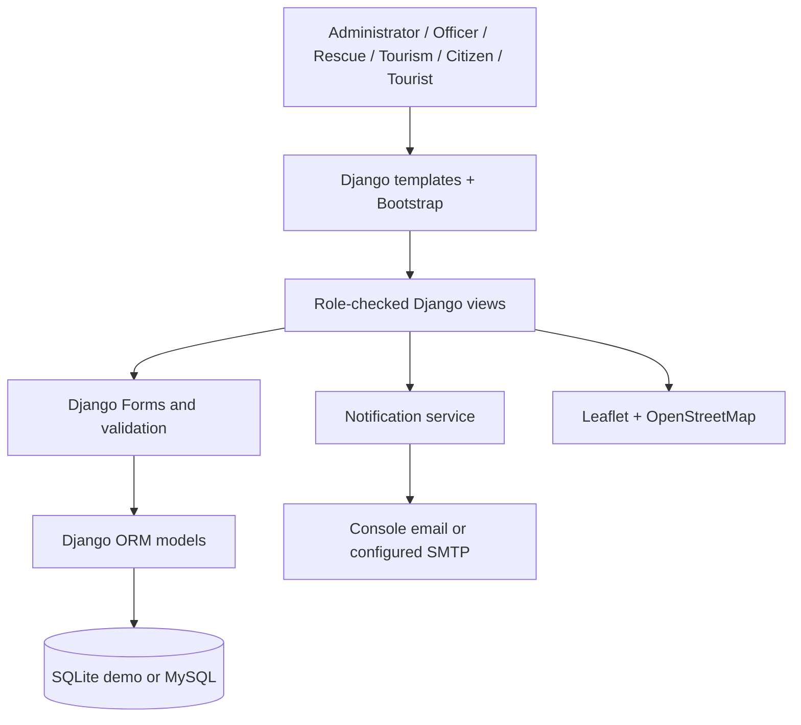

# Architecture

Reports use user-submitted information. Wildlife locations are recorded sightings, not live tracking. Fire risk is a deterministic score based on reported severity. Booking capacity is checked transactionally. Profiles carry one role; superusers have admin access.
